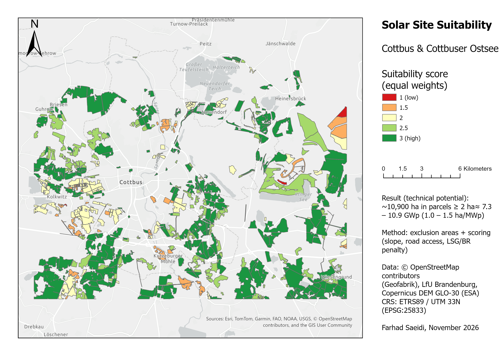
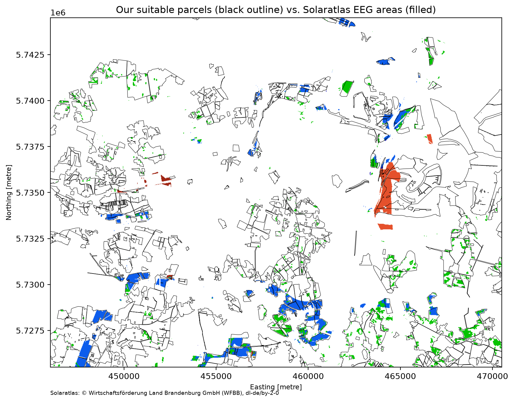

# Solar Site Suitability – Cottbus & Cottbuser Ostsee

I study at BTU in Cottbus and wanted to find out which open land around the city could be used for ground-mounted PV (Freiflächen-PV), how big these areas are and how much capacity they could have.

The analysis is done in Python (GeoPandas, Rasterio, NumPy). I used ArcGIS Pro to check the results, to draw the mining area and to make the final map.



## Result

| | |
|---|---|
| Study area | about 46,500 ha (24.5 × 19 km) |
| Suitable parcels (≥ 2 ha) | 490 parcels, about **10,900 ha** |
| Capacity (1.0–1.5 ha per MWp) | about **7.3–10.9 GWp** |

This is only the technical potential. I did not include grid connection, land ownership, soil quality or municipal planning, so the real potential is much smaller.

The 10 best parcels are in `outputs/tables/top10_parcels.csv`.

## Data

- **Protected areas:** WFS of LfU Brandenburg
- **Elevation:** Copernicus DEM 30 m
- **Land use, water, roads:** OpenStreetMap (Geofabrik shapefiles)
- **Comparison:** Solaratlas Brandenburg (WMS)

Coordinate system for everything: EPSG:25833 (ETRS89 / UTM 33N).

## What I did

### 1. Exclusion

I kept only open land from OSM (`farmland`, `meadow`, `grass`, `scrub`, `heath`) and removed:

- water and wetlands (including the Cottbuser Ostsee)
- strictly protected areas (FFH, NSG, SPA)
- the active / recently closed mining area

OSM does not show the mining area well – some of the spoil areas are tagged as grass or scrub. So I drew the mining area myself in ArcGIS Pro from satellite images (`data/manual/`).

I also cut a 10 m strip along roads, so that fields on both sides of a road are separate parcels.

### 2. Slope

Slope in degrees, calculated from the DEM with `numpy.gradient`. Parcels are removed if the mean slope is over 10° or more than 25 % of the pixels are steeper than 10°. I added the second rule because the mean alone can hide steep parts of a parcel.

### 3. Scoring

| Criterion | 3 points | 2 points | 1 point | 0 points |
|---|---|---|---|---|
| Mean slope | < 3° | 3–6° | 6–10° | – |
| Distance to road | < 500 m | 500–1000 m | 1–2 km | > 2 km |

Only roads that trucks can use are counted (no tracks or footpaths).

Parcels that are more than 50 % inside a landscape protection area (LSG) or biosphere reserve (BR) get −1 point. I did not exclude them, because in Brandenburg PV in LSG is possible under certain conditions ([MLEUV 2026](https://mleuv.brandenburg.de/sixcms/media.php/9/Rahmenbedingungen-konventionelle-Photovoltaik.pdf)).

I calculated two scores:
- equal weights: 0.5 × slope + 0.5 × road
- slope more important: 0.7 × slope + 0.3 × road

### 4. Size and capacity

Parcels under 2 ha are removed. With 1.0–1.5 ha per MWp, 2 ha is about 1.3–2 MWp, which is roughly the smallest size for a commercial PV park. Capacity = area ÷ (1.0 to 1.5 ha per MWp).

## What I found

- Road access does not really matter here. The median distance to a road is only 7 m, because field borders in OSM usually follow roads. Almost every parcel gets full road points.
- The minimum size does not change much. With 5 ha instead of 2 ha there are 30 % fewer parcels (347), but only 4 % less area. Most of the area is in big parcels.
- The weighting does not change the top 10. Both weightings give the same 10 parcels. The reason is that the road score is almost the same for all parcels, so the ranking depends on slope and parcel size.

## Comparison with Solaratlas Brandenburg



The Solaratlas layer shows areas that can get EEG funding: strips along motorways and railways, former conversion areas, spoil heaps (Halden), artificial lakes and farmland with poor soil (Bodenwertzahl < 23). Because it is only a WMS, I compared it visually.

- Most Solaratlas areas are inside my parcels, but they are much smaller. My result is the broad technical potential, Solaratlas shows the part that can get funding.
- Solaratlas marks the spoil heaps of the old mine as suitable. I excluded them, because I cannot check with my data if the ground is stable.

## Limitations

- The Copernicus DEM includes trees and buildings, so slopes at forest edges are too high. A 1 m DGM from LGB Brandenburg would be better.
- OSM land use is not complete. Land without a tag is not included.
- The road class in OSM does not say if heavy trucks are really allowed.
- PV in LSG has extra rules (for example max. 75 ha per project). I did not check them for each parcel.
- My mining boundary is drawn by eye, so it is not exact.
- All thresholds (10°, 25 %, 2 ha, the weights) are my own assumptions.

## Ideas for next steps

- Give extra points to EEG strips along motorways and railways.
- Use official data for restricted mining areas (LBGR Brandenburg) instead of my own drawing.
- Add soil quality and distance to substations.

## How to run

```
python -m venv .venv
.venv\Scripts\activate
pip install -r requirements.txt
```

1. Download `brandenburg-latest-free.shp.zip` from Geofabrik and extract it to `data/raw/osm/`.
2. Download the Copernicus DEM tile `Copernicus_DSM_COG_10_N51_00_E014_00_DEM.tif` to `data/raw/`.
3. Run the scripts in `src/` by number. The three `01_` scripts can run in any order.

Raw and processed data are not in the repository because they are too big.

## Folder structure

```
data/manual/      mining area I digitized
outputs/maps/     final map and Solaratlas comparison
outputs/tables/   top 10 parcels
src/              Python scripts (config.py + steps 01–07)
```

## Data sources and licenses

- © OpenStreetMap contributors (ODbL), via Geofabrik
- LfU Brandenburg – protected areas (WFS)
- Copernicus DEM GLO-30 © DLR e.V. 2010–2014 and © Airbus Defence and Space GmbH 2014–2018, provided under COPERNICUS by the European Union and ESA
- Solaratlas: © Wirtschaftsförderung Land Brandenburg GmbH (WFBB), dl-de/by-2-0
- Basemap: Esri Light Gray Canvas

---

Farhad Saeidi – M.Sc. Umwelt- und Ressourcenmanagement, BTU Cottbus-Senftenberg
